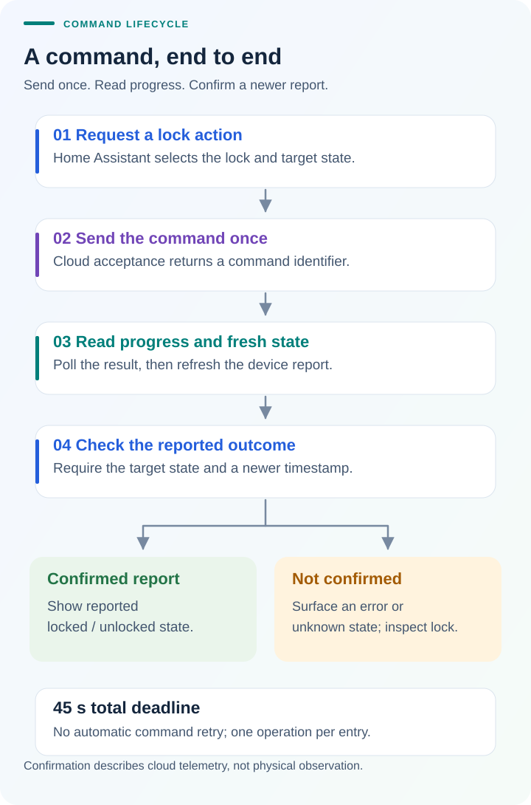

# How DESLOC reaches Home Assistant

The integration turns the DESLOC app's cloud protocol into Home Assistant lock
and sensor entities. The optional [dashboard card](https://github.com/ha-homelab/ha-desloc-card)
uses those entities; it does not handle the DESLOC account itself.

## From app traffic to an integration

The starting point was a C100 Plus controlled through the DESLOC iOS app with
Bluetooth disabled. Captured requests established the cloud device list,
reported state fields, and separate lock/unlock command and result endpoints.
Read requests were reproduced with [mimic](https://github.com/littledivy/mimic)
and the asynchronous client. Login behavior was checked against the iOS capture
and the Android app's password transformation. The
[protocol notes](protocol.md) preserve what was observed and what remains
unverified, with synthetic identifiers in examples.

Those observations became an asynchronous HA integration with interactive
authentication, automatic discovery, separate entities per lock, and explicit
command confirmation. Physical C100 Plus checks established lock/unlock and
permanent PIN creation through HA, including use of the PIN at the keypad.
D110 Plus owners subsequently reported success; see the
[compatibility evidence](compatibility.md) for the exact scope of their reports.

## Setup and discovery

1. Authenticate with email/password and any requested email code, or import an
   existing app session. HA retains the resulting session token and installation
   ID, not the password or temporary password digest.
2. Read the account's default-group device list, following its pagination
   cursor. Add every returned lock automatically, with one HA entry per lock.
3. Expose reported bolt state, battery percentage, and Wi-Fi signal. Preserve
   stable device identity and existing entity IDs during reconfiguration.

A new DESLOC login can invalidate the phone app's session. Importing its current
session avoids a competing login; it does not guarantee a permanent token.
Rejected credentials stop requests and require interactive reauthentication.
There is no background login loop. See [authentication](authentication.md).

Normal polling updates configured locks once per minute. Coordinators using the
same account session share an in-flight device-list request and a short-lived
read snapshot, reducing duplicate reads. Command confirmation explicitly asks
for a fresh request. Physical commands are never served from this cache or
replayed. Run **Reconfigure** to discover locks added to the account later;
ordinary polling does not create new entries. Accounts with multiple populated
pages or multiple groups/homes still need real-world validation.

## What happens when you press Lock or Unlock

HA requests the target state for one lock. After the preflight checks, the
integration sends one physical command and receives a command identifier.
Acceptance is only the start: it polls the command result, then refreshes device
state until a newer report matches the requested state, or the bounded attempt
ends. The total command deadline is 45 seconds.

Only one lock or PIN operation can run at a time for an entry. A timeout,
rejected command, or unconfirmed report surfaces an error; stale state can become
unknown. The integration does not automatically repeat the physical command.
A matching report is cloud telemetry, not independent observation of the bolt
or a sensor proving that the door is closed.

Result expiry (`2104`) does not cancel an accepted command: delayed physical
execution has been observed. The integration stops querying that result and
uses the remaining 45-second budget for fresh state reads every two seconds.
A successful, newer report matching the requested state can complete the
operation, while diagnostics retain the expired result and missing command
acknowledgement separately. Without that report, the operation ends with an
uncertain timeout. Neither path repeats the physical command. The state
freshness flag explains any remaining `Unknown` state. See
[troubleshooting](troubleshooting.md#command-timeout-or-unknown-state).

## Creating a permanent PIN user

The integration's **Configure** form first validates input and reads existing
access users. It creates the required user and submits the PIN write once,
then polls for completion and verifies the reported PIN. An existing matching
user with a PIN is reported instead of being silently reset. Partial failure
can leave an uncertain result and is not repaired by automatic retries or
deletion. Follow the [PIN-user guide](pin-users.md) before retrying manually.

## What the result provides

The result is cloud control through standard HA entities, a separate optional
dashboard card, and 24 bundled language packs for the integration's interface.
The [release results](release-results.md) show the automated checks and retained
evidence for v0.4.0. Those checks complement the physical and community reports;
they do not establish compatibility with every discovered model.

Local/offline control, Bluetooth control, activity history, jam detection, and
PIN editing/deletion/schedules are not implemented. Discovery is intentionally
broad so that owners can test additional models and report useful evidence.
