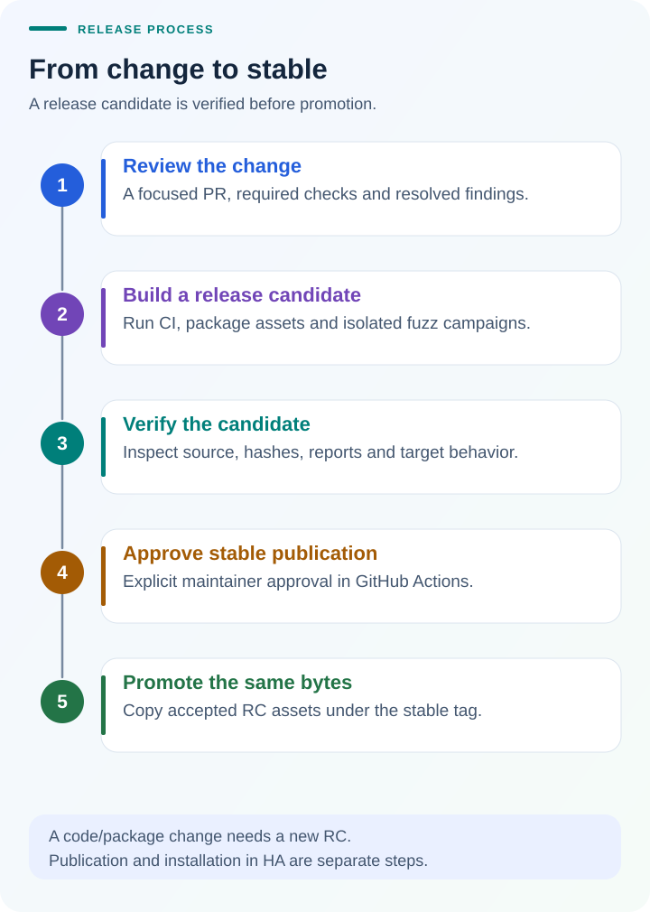

# Release results: integration v0.4.0

This is a **static snapshot from 15 October 2026, Pacific time**. It describes
[v0.4.0](https://github.com/ha-homelab/ha-desloc/releases/tag/v0.4.0), promoted from
v0.4.0-rc.1, rather than the current status of `main`. The workflow timestamps
fall on 16 October in UTC. Chart values and source links are also available in
[release-results.json](release-results.json).

## What was checked

- **180 pytest tests passed**, with no failures and five warnings, in the
  [RC validation run](https://github.com/ha-homelab/ha-desloc/actions/runs/38833183210).
  These cover the client, discovery, authentication, command behavior, and HA
  integration contracts with synthetic inputs.
- **24 native language packs passed validation**, including loading through
  Home Assistant's translation machinery. This is part of the test suite, not
  24 additional end-to-end device tests. See the [language guide](i18n.md).
- **9,823,752 device-parser fuzz executions completed** within the campaign's
  configured 60-second mutation budget. The Atheris target exited successfully.
  The published [fuzz report](https://github.com/ha-homelab/ha-desloc/releases/download/v0.4.0/fuzz-report.json)
  records the target and count; the [fuzzing guide](fuzzing.md) explains isolation
  and what the target exercises. Startup and packaging are outside that budget.
- **All six published files, including the release manifest, matched the RC
  byte for byte.** The [stable promotion run](https://github.com/ha-homelab/ha-desloc/actions/runs/38839556505)
  verified the accepted candidate's provenance. The release includes checksums
  and its source manifest.

The source revision was
[`82350a2`](https://github.com/ha-homelab/ha-desloc/commit/82350a2b4029d28dc3d2bcf8ad180c301113dc40).
The companion [card results](https://github.com/ha-homelab/ha-desloc-card/blob/2029dcd0f3077c2c0ccce43c2ee8129152a27329/docs/release-results.md)
cover frontend tests and browser checks separately.

## How a change becomes a stable release

A focused PR passes review and required checks. An explicitly requested RC
builds the release assets and runs isolated fuzz campaigns. Maintainers inspect
the candidate, its checksums and reports, and record acceptance testing before
requesting stable publication. The release job requires approval and verifies
the retained evidence before copying the accepted RC assets unchanged.

A code, dependency, or packaging change needs a new RC. A successful PR build
alone does not publish a stable release, and publication does not install it in
Home Assistant. The [release strategy](../RELEASING.md) and
[runbook](release-workflow.md) define the actual gates and commands; this diagram
is their overview.

## How to read these numbers

Test counts and fuzz inputs are not percentages of code coverage, security
guarantees, reliability measurements, or physical lock operations. No latency,
uptime, or battery-life benchmark is claimed. The physical C100 Plus and
community D110 Plus results have a different scope, documented in
[model compatibility](compatibility.md).

When documenting a later release, collect its own run IDs, source revision,
published manifest, and reports. Update the chart, JSON, and prose together;
do not silently reuse this snapshot as evidence for new code.
